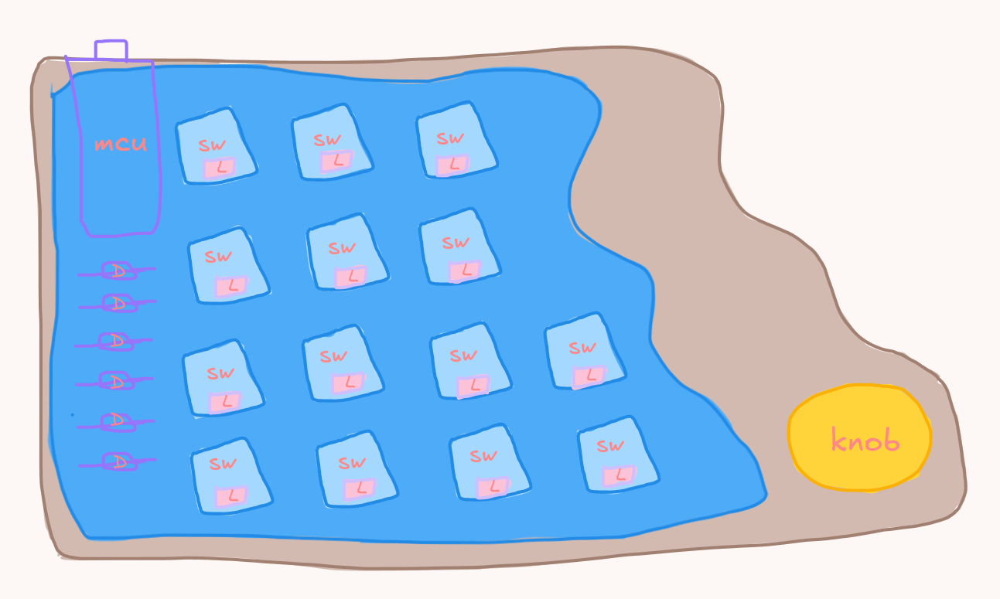
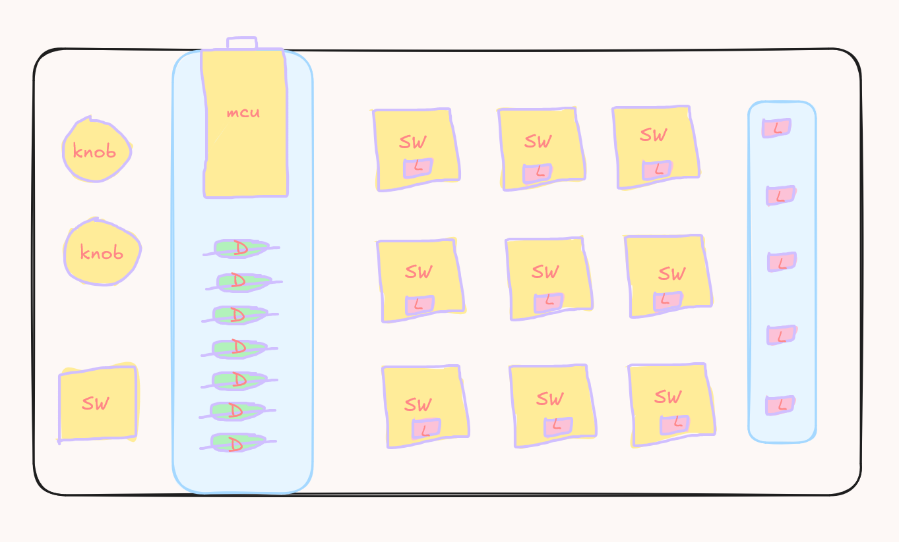

# October 12, 2026: Planning
<!-- fabricate:entry 354 -->

So I finally started working on my first big hardware project which is going to be a macropad.

I did some basic planning for now:
- beach themed
- 12-14 keys (depends on what size it will finally be, idk for now)
- a rotary encoder knob
- rgb backlighting
- whatever microcontroller can fit in the inputs easily
- battery/wired is still undecided (maybe wired for now because it's my first project in this area)

I made a small mockup design in Excalidraw. It's not super good-looking because i made it on my laptop using the trackpad...

before i finalised this design, i was also thinking of using acrylic sheets, etc. in a cool looking design but it's quite confusing and i'm not sure how much grant would i need to make the macropad so i decided to skip that design. i took inspiration from designs i saw on pinterest and created this mockup before i finalised the beach theme.

**Total time spent: 1.2hr**
