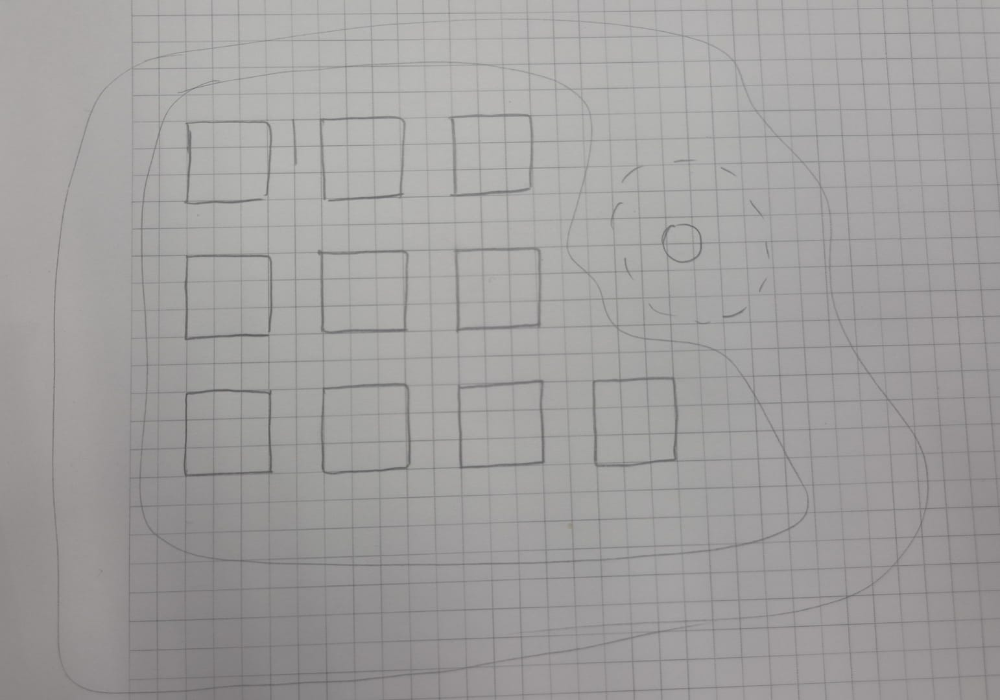
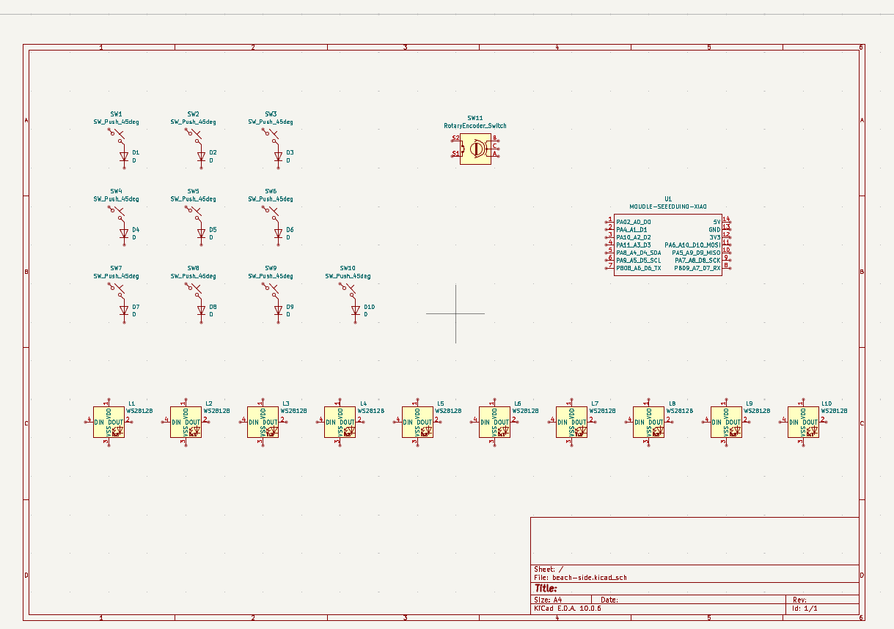
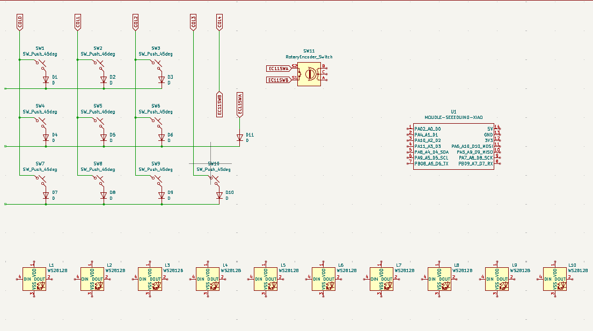

# October 12, 2026: Planning
<!-- fabricate:entry 354 -->

So I finally started working on my first big hardware project which is going to be a macropad.

I did some basic planning for now:
- beach themed
- 12-14 keys (depends on what size it will finally be, idk for now)
- a rotary encoder knob
- rgb backlighting
- whatever microcontroller can fit in the inputs easily
- battery/wired is still undecided (maybe wired for now because it's my first project in this area)

I made a small mockup design in Excalidraw. It's not super good-looking because i made it on my laptop using the trackpad...

before i finalised this design, i was also thinking of using acrylic sheets, etc. in a cool looking design but it's quite confusing and i'm not sure how much grant would i need to make the macropad so i decided to skip that design. i took inspiration from designs i saw on pinterest and created this mockup before i finalised the beach theme.

**Total time spent: 1.2hr**

# October 12, 2026: Started with Schematics

I started by reading the guide on [hackpad.hackclub.com](https://hackpad.hackclub.com) and setting up the kicad project in my github repo (cloned the repo and selected it as project destination, now i have a same named folder from kicad in the main repo too) [took some help from ai, especially for the gitignore file, etc.]

Then I finally started working on the schematics for the pcb. Installing the care package was straighforward enough and then i just satrted putting the components in the editor then i realised i forgot to turn on lapse :( ....

Since I didn't do much work on the pcb till now I just decided to start over with placing the components after starting lapse recording.

I referenced the orpheus pad shown on the hackpad guide to cross check the symbols i need to add and to see what's a good way to make the schem for more amount of keys and other components.
So referencing the schem for that, I just put in all the components that I planned to include in my design for the first part. 

At this point I realised that I need to finalise the amount of keys I want in my macropad. So to get a rought idea of the size I want the macropad to be, I just decided to draw it physically on a paper with the actual switch sizes.

As you can see in the drawing, I finalised 10 switches and one rotary encoder (the switch is 15.6mm according to google) and also the rgb leds as i planned originally. I didn't draw the mcuand diodes and leds because this was just for sizing.

I put in all the components neatly in the editor.

And then I started working on the wiring. I took some time to figure out how to make the tag-shaped labels (they are called global labels as i now know) and made the switch matrix. I just started to work on the rotary encoder wiring too, but then I had to go so i just ended the session after saving everything where it was. (wrote journal + commit to github next morning)

> I forgot to turn on lapse when i started working on this. Lapse recorded time is about 20mins only, which is why i explained all steps in this journal instead. I'll try not forgetting lapse next session.

**Total time spent: 0.7hr**